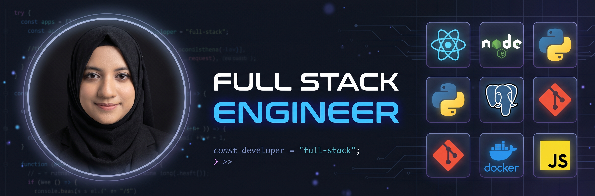

  <!-- Profile Banner -->

  

  <!-- Animated Role Typer -->
  

    
  

  <!-- Quick Social Badges -->
  

    
    &nbsp;
    
    &nbsp;
    
    &nbsp;
    
  

---

## 👩‍💻 About Me

I am a **Full Stack Engineer** and currently an **Engineer Intern at Tynoc Tech** based in Bangladesh. I specialize in the modern **JavaScript/TypeScript** ecosystem, building performant full-stack web applications, dependable backend architectures, and clean, accessible user interfaces.

With hands-on experience designing relational data models, role-based workflows, and secure RESTful services, I am focused on engineering software that scales smoothly under production requirements. In parallel, I am actively expanding my skillset toward **AI Engineering**—integrating LLMs, vector search, and Retrieval-Augmented Generation (RAG) into practical web products.

- 🔭 **Current Focus:** Engineering production-ready full-stack applications & exploring AI pipelines.
- 💡 **Core Philosophy:** Clean code, robust API contracts, and continuous algorithmic problem solving.
- 📍 **Location:** Bangladesh.

---

## 💼 Professional Experience

### **Full Stack Engineer Intern** · **Tynoc Tech**
*From October 14 to November 14 · 

- Collaborating on full-stack application modules across frontend components and backend services.
- Designing and integrating modular RESTful APIs with relational and NoSQL databases.
- Implementing authentication, role-based access control (RBAC), and responsive interface systems.
- Emphasizing code quality, schema validation, and maintainable application structure.

<!-- You can add your specific joining date, team metrics, or major milestone achievements below as you progress -->

---

## 🛠️ Technical Stack & Skills

### **Frontend Engineering**

  

### **Backend & API Architecture**

  

### **Databases & Data Layer**

  

### **DevOps, Tools & Services**

  

### **Currently Exploring (AI & Advanced Engineering)**

  

> *Note: Technologies listed under "Currently Exploring" represent active learning pathways and experimental prototypes, distinguishing them from core production stack skills.*

---

<h2 align="center">🚀 Featured Projects</h2>

  Building impactful digital solutions through full-stack engineering,
  scalable backend systems, and AI-powered applications.

<table>
<tr>
<td width="50%" valign="top">

<h3>📦 <a href="https://github.com/sumai-suchi/ParcelPilot">ParcelPilot</a></h3>

<strong>Full-Stack Logistics Management Platform</strong>

A comprehensive logistics platform designed to manage end-to-end parcel delivery operations, multi-hub tracking, and courier dispatching.

<strong>✨ Key Features</strong>
<ul>
<li>RBAC supporting five user roles</li>
<li>Multi-hub shipment tracking and validated status transitions</li>
<li>Courier dispatch and digital proof of delivery</li>
<li>Stripe webhooks and Redis-backed OTP verification</li>
<li>JWT authentication and role-based dashboards</li>
</ul>

<strong>🛠 Tech Stack</strong>

<a href="https://github.com/sumai-suchi/ParcelPilot"><strong>📂 Repository</strong></a>
&nbsp; | &nbsp;
<a href="https://parcelpilot-frontend-phi.vercel.app/"><strong>🌐 Live Demo</strong></a>

</td>
<td width="50%" valign="top">

<h3>🧠 <a href="https://github.com/sumai-suchi/insight-ai">Insight AI</a></h3>

<strong>AI-Powered Content Writing & News Platform</strong>

An AI-powered content workspace that helps users create, edit, optimize, and publish articles while accessing aggregated news content.

<strong>✨ Key Features</strong>
<ul>
<li>AI-powered content generation and editing</li>
<li>SEO analysis and plagiarism detection</li>
<li>Article drafts, previews, and publishing workflow</li>
<li>Engagement tracking and content optimization</li>
<li>Gemini AI and Guardian API integration</li>
<li>Better Auth authentication and Stripe payments</li>
</ul>

<strong>🛠 Tech Stack</strong>

<a href="https://github.com/sumai-suchi/insight-ai"><strong>📂 Repository</strong></a>
&nbsp; | &nbsp;
<a href="https://insight-ai-ochre.vercel.app/"><strong>🌐 Live Demo</strong></a>

</td>
</tr>

<tr>
<td width="50%" valign="top">

<h3>🩸 BloodCare</h3>

<strong>Full-Stack Blood Donation Platform</strong>

A user-friendly blood donation platform connecting blood donors with patients while simplifying donor management and donation support.

<strong>✨ Key Features</strong>
<ul>
<li>Donor and patient connectivity</li>
<li>Firebase authentication and user management</li>
<li>Blood donation support through Stripe integration</li>
<li>Interactive and responsive user interface</li>
</ul>

<strong>🛠 Tech Stack</strong>

<a href="YOUR_BLOODCARE_GITHUB_URL"><strong>📂 Repository</strong></a>
&nbsp; | &nbsp;
<a href="YOUR_BLOODCARE_LIVE_URL"><strong>🌐 Live Demo</strong></a>

</td>

<td width="50%" valign="top">

<h3>⚙️ <a href="https://github.com/sumai-suchi/gearup-backend">GearUp Apollo</a></h3>

<strong>Equipment Rental Marketplace Backend</strong>

A backend system for an equipment rental marketplace that manages secure rental transactions between equipment providers and customers.

<strong>✨ Key Features</strong>
<ul>
<li>Role-based authentication and authorization</li>
<li>Equipment and rental management APIs</li>
<li>JWT access and refresh token authentication</li>
<li>Atomic database transactions using Prisma</li>
<li>Input validation and administrative controls</li>
</ul>

<strong>🛠 Tech Stack</strong>

<a href="https://github.com/sumai-suchi/gearup-backend"><strong>📂 Repository</strong></a>

</td>
</tr>
</table>

---

## 📊 GitHub Statistics

  <table border="0">
    <tr>
      <td align="center" valign="middle">
        
      </td>
      <td align="center" valign="middle">
        
      </td>
    </tr>
    <tr>
      <td colspan="2" align="center" valign="middle">
        
      </td>
    </tr>
  </table>

---

## 📈 Contribution Activity

  

> *Contribution counts reflect public repository commits, pull requests, and code reviews per GitHub's contribution aggregation policies.*

---

## 🧩 Problem Solving & Competitive Programming

Algorithmic practice and data structure foundations are central to my day-to-day engineering discipline.

  

    
    &nbsp;
    <!-- Codeforces Placeholder: Replace URL once available -->
    
  

  

---

## 🎯 What I Am Learning & Exploring

My technical roadmap focuses on solidifying backend architecture while adopting practical AI engineering:

- **System Design & Distributed Backends:** Implementing Redis caching layers, query indexing in PostgreSQL, and modular service patterns.
- **Data Structures & Algorithms:** Maintaining continuous problem-solving consistency on LeetCode.
- **Python for AI Systems:** Developing scripts and data processing pipelines for AI workflows.
- **LLM Integrations & RAG:** Constructing retrieval pipelines with vector stores and semantic search.
- **Agentic Workflows:** Exploring LangChain, LangGraph, and tool-augmented autonomous AI agents.

---

## 🤝 Let's Connect & Collaborate

I am open to discussing engineering opportunities, full-stack projects, open-source initiatives, and AI explorations:

- **Full Stack Development:** Building production Next.js / TypeScript applications.
- **Backend & APIs:** Designing RESTful services, database schemas, and micro-utilities.
- **AI-Powered Applications:** Prototyping LLM integrations and modern AI-enhanced tools.

  
  &nbsp;
  
  &nbsp;
  
  &nbsp;
  

  Designed with care · Built by <b>Sumaya Akhtar</b>

